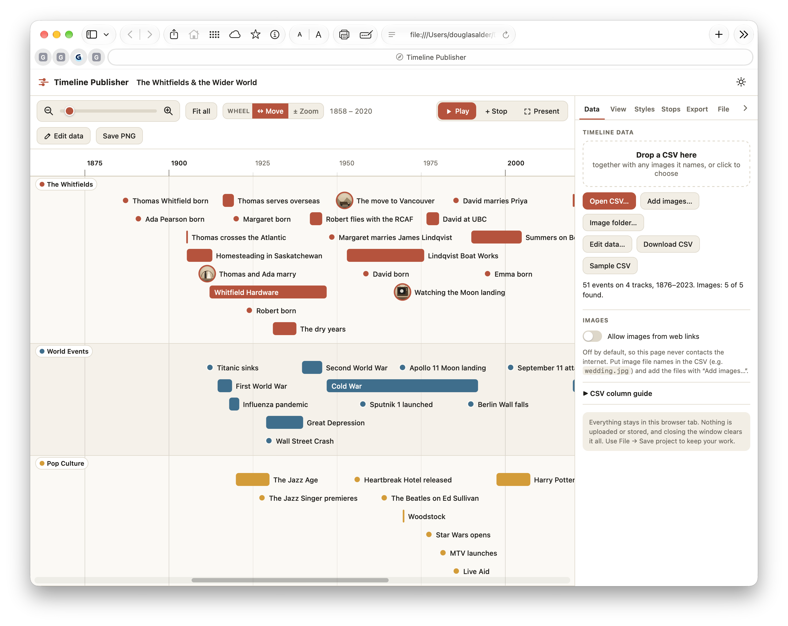

# Timeline Publisher
[🚀 Launch Timeline Publisher](Timeline%20Publisher.html)
Create beautiful, interactive storytelling timelines and animated slideshows from your own data. Transform spreadsheet rows into stunning visual narratives with 3D visualization, video export, and web publishing—all on your Mac.



## Features

✨ **Visual Timeline Creation**
- Drag-and-drop data import from CSV files
- Interactive timeline visualization with pan and zoom
- Color-coded tracks for organizing events by category
- Customizable event styling and labels

🎬 **Presentation & Animation**
- Create slideshow "stops" to guide viewers through the timeline
- Play/pause slideshow with smooth animations
- Keyboard navigation and full-screen presentation mode
- Configurable stop timing (hold duration and transition speed)

🎨 **3D Visualization**
- Toggle 3D view for perspective-based timeline display
- Adjustable camera controls: tilt, turn, zoom, focus, and depth
- Smooth perspective-corrected label rendering
- Toggle 3D labels on/off for clarity

🌙 **Visual Effects**
- Vignette effect with customizable parameters:
  - Edge darkening intensity and feather
  - Frame shape customization (square to circular)
  - Color selection (black, sepia, white, or custom)
  - Include/exclude from exported videos and images

📤 **Export & Publish**
- **PNG Export**: Save individual frames at any resolution
- **MP4 Video Export**: Create high-quality animations with adjustable FPS and resolution
- **CSV Download**: Export your timeline data for backup or external use
- **Web Publishing**: Generate standalone HTML pages for sharing (read-only view)

🖥️ **Mac App Features**
- Native macOS menu bar integration with keyboard shortcuts
- Remembers window size and position between launches
- File dialogs for saving projects and exporting media
- Dock integration and file association (JSON, CSV, TSV)
- Proper "unsaved changes" prompt before closing
- Show in Finder integration for quick access to exported files

📊 **Data Management**
- Import data from CSV files with intelligent track detection
- Built-in data table editor for live editing
- Track visibility toggle to show/hide event categories
- Stop-to-track linking (stops skip when their track is hidden)

## Quick Start

### Installation

1. **For macOS users**: Download the latest `.dmg` from [Releases](https://github.com/dougalder/timeline-publisher/releases)
2. **For web users**: Open the HTML version directly in any modern browser

### First Timeline

1. **New Project**: Launch the app and choose "New Timeline" from File menu
2. **Add Data**: Click File › Import CSV and select a spreadsheet with columns: Title, Start Date, End Date, Description
3. **Organize**: Use the Data tab to manage events; use View tab to adjust colors and styling
4. **Visualize**: Pan and zoom to explore your timeline; toggle 3D view for perspective
5. **Publish**: Create stops in Slideshow tab, then export as video, PNG, or web page

## Requirements

### macOS App
- macOS 10.13 or later
- 50MB disk space
- No internet connection required

### Web Version
- Any modern browser (Chrome, Safari, Firefox, Edge)
- Canvas and WebGL support
- No installation needed

## Project Format

Timeline Publisher uses JSON for project files:

```json
{
  "title": "My Timeline",
  "rows": [
    {
      "title": "Event Name",
      "startDate": "2020-01-15",
      "endDate": "2020-03-20",
      "description": "What happened",
      "track": "Category Name"
    }
  ],
  "tracks": [
    {
      "name": "Category Name",
      "color": "#FF6B6B",
      "visible": true
    }
  ],
  "stops": [
    {
      "cam": { "x": 0, "y": 0, "span": 1000 },
      "title": "First Stop",
      "dur": 3,
      "hold": 2
    }
  ]
}
```

## Documentation

- **[Installation Guide](docs/INSTALL.md)** — Detailed setup instructions for macOS and web
- **[User Manual](docs/MANUAL.md)** — Complete guide with screenshots and examples
- **[Keyboard Shortcuts](docs/KEYBOARD-SHORTCUTS.md)** — All keyboard commands
- **[CSV Format](docs/CSV-FORMAT.md)** — How to structure your data
- **[FAQ](docs/FAQ.md)** — Frequently asked questions

## Building from Source

### Prerequisites
- Node.js 18+ and npm
- Electron and build tools

### Development

```bash
# Install dependencies
npm install

# Run in development mode (web version)
open app/index.html

# Or run the Electron app
npm start

# Run end-to-end tests
npm test
```

### Building macOS App

```bash
# Build and package for macOS
bash pack-mac.sh

# The built app appears in: out/Timeline Publisher-darwin-arm64/
```

## File Format Support

- **Projects**: `.json` (Timeline Publisher format)
- **Data Import**: `.csv`, `.tsv`, `.txt`
- **Export**: `.png`, `.mp4`, `.webm`, `.html`, `.csv`

## Architecture

Timeline Publisher is built with:
- **Frontend**: Pure HTML5, CSS3, and JavaScript
- **Desktop App**: Electron for native macOS integration
- **Rendering**: Canvas 2D + WebGL for 3D visualization
- **Testing**: Playwright for end-to-end testing
- **Build**: npm and electron-packager

All processing happens locally on your Mac—no data is ever sent to any server.

## Privacy & Security

- **No internet required**: The app works completely offline
- **No data collection**: Your timelines stay private on your device
- **No tracking**: No analytics or telemetry
- **Fully self-contained**: Everything needed is included in the app

## License

Timeline Publisher is licensed under the MIT License. See [LICENSE](LICENSE) for details.

## Contributing

We welcome contributions! See [CONTRIBUTING.md](CONTRIBUTING.md) for guidelines on:
- Reporting bugs
- Suggesting features
- Submitting pull requests
- Development workflow

## Credits

Created by [Doug Alder](https://github.com/dougalder)

## Support

- **Issues & Bug Reports**: [GitHub Issues](https://github.com/dougalder/timeline-publisher/issues)
- **Discussions**: [GitHub Discussions](https://github.com/dougalder/timeline-publisher/discussions)
- **Email**: dougalder@icloud.com

## Roadmap

### In Development
- Advanced styling options (fonts, custom CSS)
- Multi-story projects
- Collaborative editing
- Cloud sync (optional)

### Planned
- Linux and Windows apps
- Mobile web version
- Template library
- Stock footage integration

## Version History

See [CHANGELOG.md](CHANGELOG.md) for version history and release notes.

---

**Storytelling timelines, slideshows and videos from your own data. Everything stays on your Mac.**
